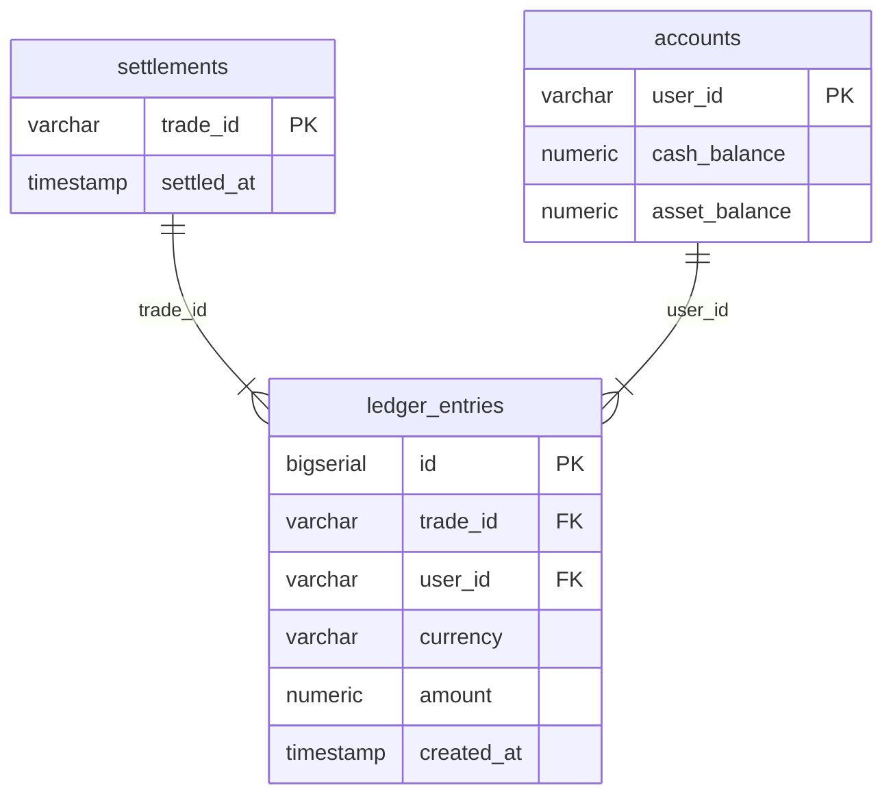

# TradeCore — High-Performance Trading Exchange Prototype

TradeCore is a high-performance prototype trading exchange backend built with Java 17+, Spring Boot 3, and PostgreSQL.

---

## Architecture Overview & Module Responsibilities

TradeCore is partitioned into five specialized modules:

1. **Part A — Matching Engine (`com.trading.engine`)**: In-memory price-time priority matching engine.
2. **Part B — Ledger & Settlement (`com.tradecore.ledger`)**: Atomic, idempotent, double-entry settlement and audit log.
3. **Part C — Event Streaming & Notifications (`com.tradecore.notification`)**: Event listening and trade settlement alerts.
4. **Part D — Risk Management & Rate Limiting (`com.tradecore.risk`)**: Pre-trade validation, per-user rate limiting, position checks, and trading circuit breaker.
5. **Part E — Integration & Infrastructure**: Unified build, Docker compose, and demo pipelines.

---

# Part D: Risk Management & Rate Limiting Module

The **`com.tradecore.risk`** module enforces strict pre-trade hygiene before any limit order reaches the Matching Engine.

```
Incoming Request
       │
       ▼
┌──────────────┐
│  RiskService │ ── (Rejected: 400, 429, 422, 503) ──> Client Rejection
└──────┬───────┘
       │ (Accepted)
       ▼
┌──────────────────┐
│  MatchingEngine  │
└──────┬───────────┘
       │ (Executed Trade)
       ▼
┌──────────────────┐
│  LedgerService   │ ── (Double-Entry Settlement)
└──────┬───────────┘
       │ (TradeSettledEvent)
       ▼
┌──────────────────┐
│ EventPublisher   │
└──────────────────┘
```

---

## 1. Risk Controls & Rules

### Order Validation Rules
- **Null Guards:** Rejects null order objects.
- **ID Validation:** Rejects missing, blank, or malformed Order IDs and User IDs.
- **Side Guard:** Requires an explicit `BUY` or `SELL` side.
- **Quantity Bounds:** Requires quantity strictly $> 0$ and $\le$ `tradecore.risk.max-order-quantity`.
- **Price Bounds:** Requires limit price strictly $> 0$ (represented using `BigDecimal`).
- **Finite Numbers:** Rejects NaN or infinite numerical inputs.

### Position Limits
- Enforces a maximum absolute position per user (`tradecore.risk.max-absolute-position`, e.g., 100 BTC).
- **BUY Order:** Projected net position = $\text{Current Position} + \text{Order Quantity}$.
- **SELL Order:** Projected net position = $\text{Current Position} - \text{Order Quantity}$.
- Rejects orders if $|\text{Projected Position}| > \text{Max Absolute Position}$.
- **Position Source:** Position data is queried from the `accounts` database table via `DatabasePositionProvider`.
- **Concurrency Guard:** Isolated per-user locks (`ConcurrentHashMap` of `ReentrantLock`) prevent two concurrent orders from bypassing the user's position limit simultaneously.
- **Fail-Safe Behavior:** If database position data is unavailable, the order is rejected safely (`POSITION_DATA_UNAVAILABLE`).

### Per-User Rate Limiting
- Implemented as an in-memory **Token Bucket Rate Limiter** (`TokenBucketRateLimiter`).
- Each user maintains an independent token bucket mapped via `ConcurrentHashMap`.
- Per-bucket thread safety is guaranteed by isolated `ReentrantLock` instances, avoiding global lock contention.
- Smooth token replenishment over the configured window duration (`tradecore.risk.rate-limit-window-seconds`).
- Memory growth is bounded by automated eviction (`evictInactiveEntries()`) of inactive buckets past the configured threshold (`tradecore.risk.rate-limiter-inactivity-minutes`).
- Uses an injectable `Clock` abstraction for deterministic test verification.

### Circuit Breaker & Global Trading Halt
- Managed thread-safely via `TradingCircuitBreaker` using an `AtomicBoolean`.
- **Manual Halt / Resume:** Admin endpoints permit instant halting and manual resumption of trading.
- **Automatic Tripping:** When enabled (`tradecore.risk.circuit-breaker.auto-trip-enabled=true`), exceeding a configured threshold of consecutive risk rejections automatically trips the breaker into a halted state.
- **Safety Guarantee:** Trading **NEVER** automatically resumes after a halt; an explicit administrative call (`/api/admin/risk/resume`) is strictly required.

---

## 2. Configuration Properties

Centralized in `application.yml` / `application.properties` under `tradecore.risk`:

| Property | Default Value | Description |
|---|---|---|
| `tradecore.risk.max-order-quantity` | `10` | Maximum single order quantity (e.g., 10 BTC) |
| `tradecore.risk.max-absolute-position` | `100` | Maximum absolute position per user (e.g., 100 BTC) |
| `tradecore.risk.rate-limit-capacity` | `20` | Max request tokens per rate-limit window |
| `tradecore.risk.rate-limit-window-seconds` | `60` | Duration of rate-limit window in seconds |
| `tradecore.risk.rate-limiter-max-entries` | `10000` | Max tracked buckets before proactive cleanup |
| `tradecore.risk.rate-limiter-inactivity-minutes` | `30` | Minutes of inactivity before eviction |
| `tradecore.risk.circuit-breaker.auto-trip-enabled` | `false` | Enable automatic circuit breaker trip on rejections |
| `tradecore.risk.circuit-breaker.consecutive-rejection-threshold` | `50` | Rejections required to trigger auto-halt |

---

## 3. HTTP Rejection Mapping

When orders are submitted via REST, risk rejections map directly to standardized HTTP status codes:

| Rejection Reason | HTTP Status Code | Description |
|---|---|---|
| `ORDER_NULL`, `ORDER_ID_INVALID`, `USER_ID_INVALID`, `SIDE_INVALID`, `INVALID_QUANTITY`, `INVALID_PRICE` | `400 Bad Request` | Invalid payload or non-positive numerical fields |
| `RATE_LIMIT_EXCEEDED` | `429 Too Many Requests` | Per-user rate limit capacity exceeded |
| `TRADING_HALTED` | `503 Service Unavailable` | Global trading is halted by circuit breaker |
| `MAX_QUANTITY_EXCEEDED`, `POSITION_LIMIT_EXCEEDED`, `POSITION_DATA_UNAVAILABLE` | `422 Unprocessable Entity` | Order size or position bounds exceeded, or position unavailable |

---

## 4. REST APIs

### Order Submission Endpoint
- `POST /api/orders`
  - Body: `{"id": "ord-1", "userId": "alice", "side": "BUY", "price": 50000.00, "qty": 2}`
  - Evaluates `RiskService.validate(order)` prior to matching engine dispatch.

### Administrative Risk Endpoints
- `GET /api/admin/risk/status` — Returns circuit breaker halt status and tracked rate limiter key counts.
- `POST /api/admin/risk/halt?reason=Volatility` — Halts global trading immediately.
- `POST /api/admin/risk/resume` — Resumes global trading.
- `POST /api/admin/risk/ratelimit/reset?userId=alice` — Resets rate limit buckets for a specified user.

> [!IMPORTANT]
> Admin endpoints are unauthenticated in this prototype for ease of local evaluation. Production deployments must enforce OAuth2/RBAC and mutual TLS.

---

## 5. Automated Tests & Verification

### Executing Tests
To run all 46 unit and integration tests across Ledger and Risk modules:

```bash
mvn test
```

### Coverage Summary (36 Risk Tests)
1. `shouldAcceptValidOrder`: Valid order is accepted.
2. `shouldRejectNullOrMalformedOrder`: Null/blank order parameters rejected.
3. `shouldRejectNonPositivePrice`: Price $\le 0$ rejected.
4. `shouldRejectNonPositiveQuantity`: Quantity $\le 0$ rejected.
5. `shouldRejectQuantityExceedingMax`: Order quantity exceeding 10 BTC rejected.
6. `shouldRejectBuyExceedingPositionLimit`: Projected BUY position $> 100$ BTC rejected.
7. `shouldRejectSellExceedingNegativePositionLimit`: Projected SELL position $< -100$ BTC rejected.
8. `shouldMaintainIndependentLimitsPerUser`: Rate limits isolated per user.
9. `shouldAcceptRequestsWithinLimit`: Submissions within rate capacity accepted.
10. `shouldRejectRequestsBeyondLimit`: Excess requests rejected.
11. `shouldHandleConcurrentRequestsThreadSafely`: Thread safety under concurrent load verified.
12. `shouldRefillDeterministicallyOverTime`: Injectable test clock verifies deterministic token replenishment.
13. `shouldHaltManually`: Global trading halt blocks order processing.
14. `shouldResumeTrading`: Resuming trading restores order processing.
15. `shouldBeThreadSafeUnderConcurrentAccess`: Circuit breaker thread-safe under multithreaded toggles.
16. `rejectedOrdersNeverReachMatchingEngine`: Pipeline demo verifies risk rejections short-circuit before engine invocation.
17. `shouldFailSafelyWhenPositionDataUnavailable`: Missing position data triggers safe rejection.

---

## 6. Prototype vs. Production Comparison

| Feature | Prototype Implementation | Production Requirement |
|---|---|---|
| **Rate Limiter Storage** | In-memory `ConcurrentHashMap` Token Bucket | Distributed Redis cluster with Lua scripts or Redisson |
| **Position Data Source** | Synchronous database lookup against `accounts` | Low-latency in-memory cache synchronized with order book state |
| **Admin Endpoint Security** | Development-only unauthenticated REST endpoints | OAuth2 / OIDC authentication with RBAC and mTLS |
| **Circuit Breaker Persistence** | In-memory `AtomicBoolean` state | Distributed consensus (e.g., ZooKeeper / Etcd) across all engine nodes |
| **Order Pipeline** | Synchronous service calls | High-throughput Disruptor / RingBuffer with async event streaming |

---

# Part B: Ledger & Settlement Module

## Database Schema

Managed tables in PostgreSQL:

1. **`accounts`**: User USD and BTC balances. Database constraints strictly prohibit negative balances.
2. **`settlements`**: Unique `trade_id` primary key for idempotent settlement.
3. **`ledger_entries`**: Append-only double-entry audit log ensuring zero-sum financial movements.



---

## Double-Entry Invariants

For every executed trade:
1. Buyer USD Debit: `- (price * qty)`
2. Seller USD Credit: `+ (price * qty)`
3. Seller BTC Debit: `- qty`
4. Buyer BTC Credit: `+ qty`

$$\sum \text{amount}_{\text{USD}} = 0, \quad \sum \text{amount}_{\text{BTC}} = 0$$

---

## Inspection SQL Queries

### Check Current Balances
```sql
SELECT user_id, cash_balance, asset_balance FROM accounts ORDER BY user_id;
```

### Check Double-Entry Audit Trail
```sql
SELECT id, trade_id, user_id, currency, amount, created_at
FROM ledger_entries
WHERE trade_id = 'T-100'
ORDER BY id ASC;
```

### Verify Zero-Sum Invariant
```sql
SELECT trade_id, currency, SUM(amount) AS net_sum
FROM ledger_entries
GROUP BY trade_id, currency
HAVING SUM(amount) <> 0;
```
